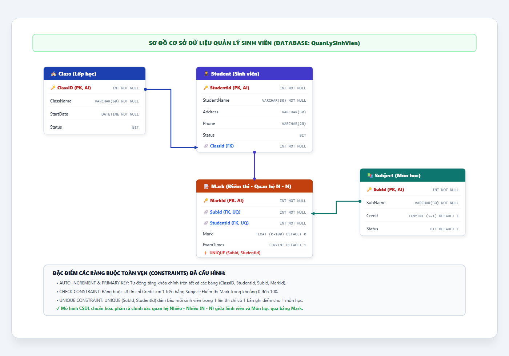

# [BÀI TẬP] TẠO CƠ SỞ DỮ LIỆU VÀ BẢNG QUẢN LÝ SINH VIÊN (QuanLySinhVien)

- **Mục tiêu:** Tạo được cơ sở dữ liệu và các bảng với đầy đủ ràng buộc toàn vẹn dữ liệu: `PRIMARY KEY`, `FOREIGN KEY`, `NOT NULL`, `AUTO_INCREMENT`, `CHECK`, `DEFAULT`, `UNIQUE`.
- **Tên CSDL:** `QuanLySinhVien`
- **Sinh viên thực hiện:** DTC245200413 (`dtc245200413-cmyk`)
- **Repository:** [https://github.com/dtc245200413-cmyk/jwbd-2023-sql-student-management](https://github.com/dtc245200413-cmyk/jwbd-2023-sql-student-management)
- **Mã nguồn tham khảo:** [https://github.com/codegym-vn/jwbd-2023-sql-student-management](https://github.com/codegym-vn/jwbd-2023-sql-student-management) (nhánh `dev`)

---

## 1. MÔ TẢ CÁC BẢNG TRONG CƠ SỞ DỮ LIỆU

### Bảng 1: `Class` (Lớp học)
| STT | Tên trường | Kiểu dữ liệu | Độ dài | Ràng buộc |
|:---:|:---|:---|:---:|:---|
| 1 | `ClassID` | INT | | NOT NULL, PRIMARY KEY, AUTO_INCREMENT |
| 2 | `ClassName` | VARCHAR | 60 | NOT NULL |
| 3 | `StartDate` | DATETIME | | NOT NULL |
| 4 | `Status` | BIT | | |

### Bảng 2: `Student` (Sinh viên)
| STT | Tên trường | Kiểu dữ liệu | Độ dài | Ràng buộc |
|:---:|:---|:---|:---:|:---|
| 1 | `StudentId` | INT | | NOT NULL, PRIMARY KEY, AUTO_INCREMENT |
| 2 | `StudentName` | VARCHAR | 30 | NOT NULL |
| 3 | `Address` | VARCHAR | 50 | |
| 4 | `Phone` | VARCHAR | 20 | |
| 5 | `Status` | BIT | | |
| 6 | `ClassId` | INT | | NOT NULL, FOREIGN KEY tham chiếu đến `Class(ClassID)` |

### Bảng 3: `Subject` (Môn học)
| STT | Tên trường | Kiểu dữ liệu | Độ dài | Ràng buộc |
|:---:|:---|:---|:---:|:---|
| 1 | `SubId` | INT | | NOT NULL, PRIMARY KEY, AUTO_INCREMENT |
| 2 | `SubName` | VARCHAR | 30 | NOT NULL |
| 3 | `Credit` | TINYINT | | NOT NULL, DEFAULT: 1, CHECK: `Credit >= 1` |
| 4 | `Status` | BIT | | DEFAULT: 1 |

### Bảng 4: `Mark` (Điểm thi - Bảng trung gian quan hệ Nhiều - Nhiều giữa Student & Subject)
| STT | Tên trường | Kiểu dữ liệu | Độ dài | Ràng buộc |
|:---:|:---|:---|:---:|:---|
| 1 | `MarkId` | INT | | NOT NULL, PRIMARY KEY, AUTO_INCREMENT |
| 2 | `SubId` | INT | | NOT NULL, FOREIGN KEY tham chiếu đến `Subject(SubId)` |
| 3 | `StudentId` | INT | | NOT NULL, FOREIGN KEY tham chiếu đến `Student(StudentId)` |
| 4 | `Mark` | FLOAT | | DEFAULT: 0, CHECK: `Mark BETWEEN 0 AND 100` |
| 5 | `ExamTimes` | TINYINT | | DEFAULT: 1 |
| * | Ràng buộc duy nhất | | | `UNIQUE (SubId, StudentId)` |

---

## 2. SƠ ĐỒ MÔ HÌNH THỰC THỂ QUAN HỆ (ERD)



### Sơ đồ dạng Mermaid:
```mermaid
erDiagram
    Class ||--o{ Student : "chứa (1:N)"
    Student ||--o{ Mark : "có điểm (1:N)"
    Subject ||--o{ Mark : "được chấm (1:N)"

    Class {
        int ClassID PK,AI "Mã lớp"
        string ClassName "Tên lớp"
        datetime StartDate "Ngày bắt đầu"
        bit Status "Trạng thái"
    }

    Student {
        int StudentId PK,AI "Mã sinh viên"
        string StudentName "Tên sinh viên"
        string Address "Địa chỉ"
        string Phone "Điện thoại"
        bit Status "Trạng thái"
        int ClassId FK "Lớp"
    }

    Subject {
        int SubId PK,AI "Mã môn học"
        string SubName "Tên môn học"
        tinyint Credit "Số tín chỉ (>=1)"
        bit Status "Trạng thái"
    }

    Mark {
        int MarkId PK,AI "Mã điểm"
        int SubId FK "Mã môn học"
        int StudentId FK "Mã sinh viên"
        float Mark "Điểm thi (0-100)"
        tinyint ExamTimes "Số lần thi"
    }
```

---

## 3. CÁC BƯỚC THỰC HIỆN BẰNG CÂU LỆNH SQL

### Bước 1: Tạo cơ sở dữ liệu `QuanLySinhVien`
```sql
CREATE DATABASE QuanLySinhVien;
```

### Bước 2: Chọn Database `QuanLySinhVien` để thao tác
```sql
USE QuanLySinhVien;
```

### Bước 3: Tạo bảng `Class`
```sql
CREATE TABLE Class (
    ClassID   INT         NOT NULL AUTO_INCREMENT PRIMARY KEY,
    ClassName VARCHAR(60) NOT NULL,
    StartDate DATETIME    NOT NULL,
    Status    BIT
);
```

### Bước 4: Tạo bảng `Student`
```sql
CREATE TABLE Student (
    StudentId   INT         NOT NULL AUTO_INCREMENT PRIMARY KEY,
    StudentName VARCHAR(30) NOT NULL,
    Address     VARCHAR(50),
    Phone       VARCHAR(20),
    Status      BIT,
    ClassId     INT         NOT NULL,
    FOREIGN KEY (ClassId) REFERENCES Class (ClassID)
);
```

### Bước 5: Tạo bảng `Subject`
```sql
CREATE TABLE Subject (
    SubId   INT         NOT NULL AUTO_INCREMENT PRIMARY KEY,
    SubName VARCHAR(30) NOT NULL,
    Credit  TINYINT     NOT NULL DEFAULT 1 CHECK ( Credit >= 1 ),
    Status  BIT                  DEFAULT 1
);
```

### Bước 6: Tạo bảng `Mark`
```sql
CREATE TABLE Mark (
    MarkId    INT NOT NULL AUTO_INCREMENT PRIMARY KEY,
    SubId     INT NOT NULL,
    StudentId INT NOT NULL,
    Mark      FLOAT   DEFAULT 0 CHECK ( Mark BETWEEN 0 AND 100),
    ExamTimes TINYINT DEFAULT 1,
    UNIQUE (SubId, StudentId),
    FOREIGN KEY (SubId) REFERENCES Subject (SubId),
    FOREIGN KEY (StudentId) REFERENCES Student (StudentId)
);
```

---

## 4. TỆP MÃ NGUỒN SQL HOÀN CHỈNH
Mã nguồn câu lệnh SQL đầy đủ bao gồm cả câu lệnh tạo bảng và dữ liệu mẫu kiểm chứng có sẵn tại:
👉 [`QuanLySinhVien.sql`](QuanLySinhVien.sql)

---

## 5. LINK NỘP BÀI
- **GitHub Repository:** [https://github.com/dtc245200413-cmyk/jwbd-2023-sql-student-management](https://github.com/dtc245200413-cmyk/jwbd-2023-sql-student-management)
